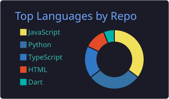

  
   
   
  

    
    
    
    
  

---

### Overview

I am an **AI Engineer and Backend Software Developer** based in Phnom Penh, Cambodia, currently pursuing a B.Sc. in Computer Studies at **Norton University**. My work centers on adapting open-source language models for domain-specific reasoning and building production web and mobile software.

- **LLM Fine-Tuning & Inference:** Supervised fine-tuning (`SFT` / `TRL`), parameter-efficient adapters (`PEFT` / `LoRA`), and quantized `GGUF` deployments on `Qwen2.5` architectures.
- **Backend & API Systems:** Asynchronous REST APIs, relational data modeling, and service integrations built with `Python`, `FastAPI`, `Flask`, and `PostgreSQL`.
- **Full-Stack & Mobile Engineering:** Modern web dashboards, Telegram Mini Apps, and cross-platform mobile applications using `TypeScript`, `React`, `Next.js`, and `Flutter`.

---

### Published Language Models ([Hugging Face · `@Maoseavik`](https://huggingface.co/Maoseavik))

| Model Repository | Base Architecture | Method & Format | Domain Application |
| :--- | :--- | :--- | :--- |
| [**`Maoseavik/agri-qwen3b-lora`**](https://huggingface.co/Maoseavik/agri-qwen3b-lora) | `Qwen/Qwen2.5-3B-Instruct` | `SFT · TRL · LoRA` | Crop disease diagnosis, treatment planning & agricultural Q&A |
| [**`Maoseavik/agrisystem-qwen2.5-3b-gguf`**](https://huggingface.co/Maoseavik/agrisystem-qwen2.5-3b-gguf) | `Qwen/Qwen2.5-3B-Instruct` | `Quantized GGUF` | Low-latency CPU and edge inference via `llama.cpp` & Ollama |
| [**`Maoseavik/agrisystem-qwen2.5-3b-adapter`**](https://huggingface.co/Maoseavik/agrisystem-qwen2.5-3b-adapter) | `Qwen/Qwen2.5-3B-Instruct` | `PEFT Adapter` | Structured symptom-to-treatment agricultural reasoning |
| [**`Maoseavik/agri-expert-adapter`**](https://huggingface.co/Maoseavik/agri-expert-adapter) | `Qwen/Qwen2.5-1.5B-Instruct` | `PEFT · SafeTensors` | Compact conversational assistant for resource-constrained hardware |

---

### Selected Engineering Projects

<table>
  <tr>
    <td width="50%" valign="top">
      <h4><a href="https://github.com/Seavik2142/ChhlatAI">ChhlatAI</a> — Conversational Commerce &amp; Copilot Inbox</h4>
      
Unified social-commerce CRM connecting Telegram, Messenger, Instagram, and TikTok with <b>Google Gemini</b> agents, automated Bakong KHQR invoicing, and receipt verification.

      
<code>TypeScript</code> <code>Python</code> <code>FastAPI</code> <code>Google Gemini</code> <code>React</code> <code>PostgreSQL</code> <code>Docker</code>

    </td>
    <td width="50%" valign="top">
      <h4><a href="https://agricultureexp.space">AgriSystem AI</a> — Agricultural Expert System</h4>
      
Bilingual (Khmer/English) agricultural advisory platform powered by custom fine-tuned <b>Qwen2.5-3B LoRA &amp; GGUF</b> models with symptom matching and localized weather risk alerts.

      
<code>Python</code> <code>Qwen2.5-3B</code> <code>PEFT / LoRA</code> <code>Flask</code> <code>PostgreSQL</code> <code>Hugging Face</code>

    </td>
  </tr>
  <tr>
    <td width="50%" valign="top">
      <h4><a href="https://github.com/Seavik2142/mini_app">Digital Keys PRO</a> — Telegram Mini App Storefront</h4>
      
High-speed Telegram WebApp storefront engineered for instant digital software key provisioning, automated inventory management, and seamless checkout. <a href="https://mini-app-alpha-roan.vercel.app">Live Demo ↗</a>

      
<code>TypeScript</code> <code>React</code> <code>Node.js</code> <code>Telegram SDK</code> <code>PostgreSQL</code> <code>Docker</code>

    </td>
    <td width="50%" valign="top">
      <h4><a href="https://github.com/Seavik2142/driving-system">Driving License Prep</a> — Mobile Examination Suite</h4>
      
Cross-platform mobile learning and mock-examination application built with Flutter and Dart to practice traffic rules, road signs, and timed theory tests.

      
<code>Flutter</code> <code>Dart</code> <code>Mobile UI</code> <code>Cross-Platform</code>

    </td>
  </tr>
  <tr>
    <td width="50%" valign="top">
      <h4><a href="https://github.com/Seavik2142/ksnmusic">KSN Music</a> — Audio Streaming Platform</h4>
      
Full-stack web audio streaming application built with Laravel and modern JavaScript, featuring smart playlists, persistent playback controls, and catalog indexing.

      
<code>Laravel</code> <code>PHP</code> <code>JavaScript</code> <code>Tailwind CSS</code> <code>MySQL</code>

    </td>
    <td width="50%" valign="top">
      <h4><a href="https://github.com/Seavik2142/School_Manage">Academic &amp; Property Management Systems</a></h4>
      
Administrative software suites engineered with Python and PostgreSQL to streamline student records, scheduling, billing, and property operations.

      
<code>Python</code> <code>JavaScript</code> <code>PostgreSQL</code> <code>PL/pgSQL</code> <code>REST API</code>

    </td>
  </tr>
</table>

---

### Technical Stack

| Domain | Technologies & Tools |
| :--- | :--- |
| **AI & Machine Learning** |       |
| **Backend & APIs** |       |
| **Frontend & Mobile** |        |
| **Data & Infrastructure** |      |

---

### Experience & Recognition

- **Backend Software Engineering Intern** — *KRU IT Solution & ETEC Center* (2026)  
  Engineered backend API services, relational database schemas, and server-side workflows within an agile engineering team.
- **Team Lead — AI Expert System & Innovation** — *Norton University · Dept. of Computer Studies* (2026)  
  Led a 4-member student engineering team across dataset curation, Qwen2.5-3B LoRA fine-tuning, and full-stack deployment for the bilingual Agriculture Expert System.
- **B.Sc. in Computer Studies (Software Development)** — *Norton University, Cambodia* (2023 – Present)  
  Awarded Foundation Year Certificate with distinguished standing; coursework in Artificial Intelligence, Software Architecture, and Distributed Systems.

---

### GitHub Activity & Telemetry

  
  

  

  <picture>
    <source media="(prefers-color-scheme: dark)" srcset="https://raw.githubusercontent.com/Seavik2142/Seavik2142/output/github-snake-dark.svg" />
    <source media="(prefers-color-scheme: light)" srcset="https://raw.githubusercontent.com/Seavik2142/Seavik2142/output/github-snake.svg" />
    
  </picture>

