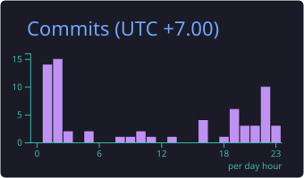
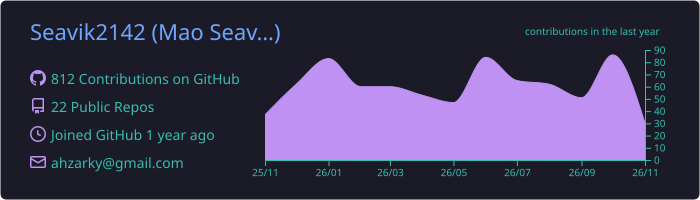

<!-- ===================================================== -->
<!--                 SEAVIK | GITHUB PROFILE               -->
<!-- ===================================================== -->

  

<h2 align="center">
  
</h2>

  <b>Software Development Student | AI Engineering Enthusiast | Open-Source Contributor</b>

  🇰🇭 Cambodia &nbsp; • &nbsp; 🌍 International Collaboration &nbsp; • &nbsp; 💡 Continuous Learning

  
  
  
  

  

---

## 👨‍💻 About Me

Hi! I'm **Seavik**, a software development student from Cambodia with a strong interest in Artificial Intelligence, Machine Learning, and Software Engineering.

I enjoy exploring open-source AI models, experimenting with LLM fine-tuning, building practical software applications, and developing solutions to real-world problems.

My goal is to grow as an **AI Engineer** while contributing to meaningful open-source projects and collaborating with developers and researchers worldwide.

### 🎯 Current Focus

- 🤖 Artificial Intelligence, Machine Learning & Deep Learning
- 🧠 Large Language Models (LLMs), Fine-Tuning & AI Agents
- 🐍 Python Backend Development & API Engineering
- 🔬 Open-Source AI Models & Experimentation
- 🌍 International Collaboration & Open-Source Contributions

**Career Interests:** AI Engineer Internships · Remote Opportunities · Python Backend Development · AI Research Collaboration

---

## ⚡ Technology Stack

### Programming Languages

  

### Frameworks & Development

  

### Database, Tools & Infrastructure

  

### AI & Machine Learning

  
  
  
  
  
  

---

## 🚀 Featured Projects

### 🤖 1. ChhlatAI

An AI-focused application exploring the integration of Large Language Models using Google's Gemini models.

**Technologies:** Google Gemini · LLM Integration · Software Development

🔗 [View GitHub Repository](https://github.com/Seavik2142/ChhlatAI)

### 🌱 2. Agricultural Expert System

An AI-focused agricultural expert system designed around agricultural knowledge and domain-specific applications.

My work includes collecting and preparing agricultural data, experimenting with open-source Qwen models, and conducting model fine-tuning experiments.

**Technologies:** Python · Qwen2.5-3B · SFT · PEFT · LoRA · Hugging Face

**Published Models & Resources:**

- [Agricultural Qwen LoRA](https://huggingface.co/Maoseavik/agri-qwen3b-lora)
- [Agricultural GGUF](https://huggingface.co/Maoseavik/agrisystem-qwen2.5-3b-gguf)
- [Agricultural Adapter](https://huggingface.co/Maoseavik/agrisystem-qwen2.5-3b-adapter)
- [Expert System Adapter](https://huggingface.co/Maoseavik/agri-expert-adapter)

### 🛒 3. Mini App

A mini application for selling products with Telegram integration.

**Technologies:** Application Development · Telegram Integration

🔗 [View Repository](https://github.com/Seavik2142/mini_app)

### 🚗 4. Driving System

A Flutter mobile application for practicing driving license examination questions.

**Technologies:** Flutter · Dart · Mobile Development

🔗 [View Repository](https://github.com/Seavik2142/driving-system)

---

## 📊 GitHub Analytics

  
  

  

---

## 📈 Contribution Activity

  

---

## 🐍 Contribution Snake Animation

  <picture>
    <source
      media="(prefers-color-scheme: dark)"
      srcset="https://raw.githubusercontent.com/Seavik2142/Seavik2142/output/github-snake-dark.svg"
    />
    <source
      media="(prefers-color-scheme: light)"
      srcset="https://raw.githubusercontent.com/Seavik2142/Seavik2142/output/github-snake.svg"
    />
    
  </picture>

---

## 🤗 Hugging Face & AI Research

I explore open-source language models and experiment with domain-specific AI applications.

### Research & Technical Interests

- Open-Source Large Language Models
- Qwen Model Experimentation
- Supervised Fine-Tuning (SFT)
- Parameter-Efficient Fine-Tuning (PEFT)
- LoRA Adapters & GGUF Models
- AI Inference & Application Integration

  

---

## 👥 Leadership & Teamwork

**Team Leader — Academic Research & Competitions**

- Led a four-member student team.
- Coordinated team responsibilities and activities.
- Participated in academic research and software development competitions.
- Developed teamwork, communication, leadership, and problem-solving skills.

---

## 📚 Currently Learning

  

---

## 🤝 Open to Collaboration

I'm interested in collaborating with developers, researchers, and open-source communities on:

- Artificial Intelligence & Machine Learning
- LLM Applications & Open-Source Models
- Python Backend Development
- AI-Powered Developer Tools
- Research & Educational Technology
- Full-Stack Software Development

I'm especially interested in long-term collaboration, meaningful engineering contributions, and learning from experienced developers and maintainers.

---

## 📫 Let's Connect

  
  
  
  

  

  <i>"Building practical solutions, exploring intelligent systems, and growing through collaboration."</i>

  

