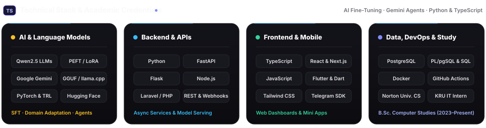

  <picture>
    <source media="(prefers-color-scheme: dark)" srcset="./assets/hero-bento.svg" />
    <source media="(prefers-color-scheme: light)" srcset="./assets/hero-bento-light.svg" />
    
  </picture>
   
   
  

    
    
    
  

 

### Selected Engineering Projects

  <picture>
    <source media="(prefers-color-scheme: dark)" srcset="./assets/projects-bento.svg" />
    <source media="(prefers-color-scheme: light)" srcset="./assets/projects-bento-light.svg" />
    
  </picture>

  <a href="https://github.com/Seavik2142/ChhlatAI"><b>01 · ChhlatAI Repository ↗</b></a>
  &nbsp;&nbsp;·&nbsp;&nbsp;
  <a href="https://agricultureexp.space"><b>02 · AgriSystem AI Live ↗</b></a>
  &nbsp;&nbsp;·&nbsp;&nbsp;
  <a href="https://mini-app-alpha-roan.vercel.app"><b>03 · Digital Keys PRO Live ↗</b></a>
  &nbsp;&nbsp;·&nbsp;&nbsp;
  <a href="https://github.com/Seavik2142/driving-system"><b>04 · Driving System ↗</b></a>
  &nbsp;&nbsp;·&nbsp;&nbsp;
  <a href="https://github.com/Seavik2142/ksnmusic"><b>05 · KSN Music ↗</b></a>

 

### Published Language Models ([`@Maoseavik`](https://huggingface.co/Maoseavik))

  <a href="https://huggingface.co/Maoseavik">
    <picture>
      <source media="(prefers-color-scheme: dark)" srcset="./assets/models-bento.svg" />
      <source media="(prefers-color-scheme: light)" srcset="./assets/models-bento-light.svg" />
      
    </picture>
  </a>

  <a href="https://huggingface.co/Maoseavik/agri-qwen3b-lora"><code>agri-qwen3b-lora</code></a>
  &nbsp;&nbsp;·&nbsp;&nbsp;
  <a href="https://huggingface.co/Maoseavik/agrisystem-qwen2.5-3b-gguf"><code>agrisystem-qwen2.5-3b-gguf</code></a>
  &nbsp;&nbsp;·&nbsp;&nbsp;
  <a href="https://huggingface.co/Maoseavik/agrisystem-qwen2.5-3b-adapter"><code>agrisystem-qwen2.5-3b-adapter</code></a>
  &nbsp;&nbsp;·&nbsp;&nbsp;
  <a href="https://huggingface.co/Maoseavik/agri-expert-adapter"><code>agri-expert-adapter</code></a>

 

### Technical Stack & Experience

  <picture>
    <source media="(prefers-color-scheme: dark)" srcset="./assets/stack-bento.svg" />
    <source media="(prefers-color-scheme: light)" srcset="./assets/stack-bento-light.svg" />
    
  </picture>

 

### Contribution Activity

  <picture>
    <source media="(prefers-color-scheme: dark)" srcset="https://raw.githubusercontent.com/Seavik2142/Seavik2142/output/github-snake-dark.svg" />
    <source media="(prefers-color-scheme: light)" srcset="https://raw.githubusercontent.com/Seavik2142/Seavik2142/output/github-snake.svg" />
    
  </picture>

